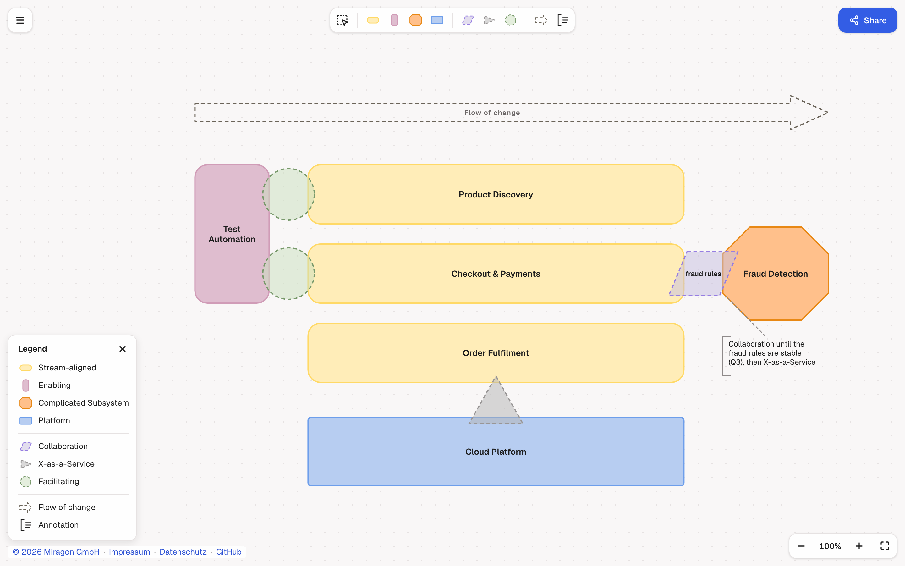

# Team Topologies Modeler — Web App

[](https://github.com/Miragon/team-topologies-modeler/blob/main/LICENSE)

The browser editor for [Team Topologies](https://teamtopologies.com/) diagrams: a Vite app on the
shared [`@miragon/team-topologies-renderer`](../../packages/renderer) core, inside the Miragon modeler
chrome ([`@miragon/modeler-shell`](https://www.npmjs.com/package/@miragon/modeler-shell), web host).
A full-bleed canvas with floating islands, no header bar, and **no backend**: everything is local,
and a diagram is shared by encoding it into the URL.

**[Live demo](https://team-topologies.modeler.miragon.io)**



## Highlights

- **The Miragon modeler chrome**, the same as in the VS Code extension: the menu top left, the tool
  palette top centre (Enter or Space on an entry places the element in the free part of the canvas),
  **Share** top right, the zoom panel bottom right (`Cmd/Ctrl` + `+` / `−`, `Cmd/Ctrl+0` for 100 %,
  `Shift+1` to fit), the legend, the problems pill and the legal line bottom left, and the
  **inspector** on the right (a bottom sheet on narrow screens) while something is selected. A fresh
  visit shows a **start screen** (New diagram, Show example, or open a file) instead of the work
  chrome.
- **Menu:** File (**New diagram**, **Open…** `Cmd/Ctrl+O` for `.tt`, `.ttm.json` and `.json`,
  **Show example**), Model (**Restore previous diagram** while the browser keeps one, **Diagram
  title…**, the **Legend** checkbox), Export (**PNG** at 2×,
  **SVG**, **JSON** `Cmd/Ctrl+S`) and Help (**Keyboard shortcuts…**, also on `?`). Undo and redo stay
  on the keys, also while a chrome control has the focus.
- **Edit by direct manipulation.** Drag from the palette to create, move, resize (resize a team to
  express cognitive load), edit labels in place; diagram-js keeps the history.
- **Multi-selection.** `Cmd/Ctrl+A`, a Shift+drag lasso or Shift+click select several elements; drag,
  nudge (arrow keys), copy or delete them together, each as one undo step.
- **Annotations.** Free-text notes (rationale, open questions, planned changes) from the palette, or
  attached to an element through its context pad.
- **Inspector.** For the selected element: team type or interaction mode, name and description,
  custom fill and outline colours (with a reset), detach an annotation, or delete.
- **Drop a file** anywhere on the page: a `.tt`, `.ttm.json` or `.json` file opens. Replacing a
  diagram (New diagram, Show example, a file, a shared link) offers **Undo** in a toast (and on
  `Cmd/Ctrl+Z` while the canvas has nothing else to undo) instead of asking first. The replaced
  diagram stays in the browser as the previous diagram, so **Restore previous diagram** brings it
  back after the first edit too (and swaps the two again).
- **Problems.** What the import could not take (an annotation attached to an element that is gone)
  shows in the problems pill; its list selects the annotation, and deleting the annotation removes
  its problem.
- **Share via URL, no server.** **Share** copies a self-contained link: the whole diagram is
  LZ-compressed into the URL hash (`#d=…`). Opening that link restores the diagram, also when it is
  pasted into an open tab; a damaged link says so.
- **Autosave.** Every change goes to `localStorage` and into the address bar, so a reload brings the
  diagram back; the legend remembers whether it is open. A shared link that replaces your own
  diagram leaves that one in the browser's copy until you edit the shared one; then it becomes the
  previous diagram. The autosave never writes over a diagram it has no room to keep.
- **Offline-friendly.** No CDN calls; Geist and Geist Mono are bundled.

## Run it

From the repo root (Node ≥ 22.13):

```bash
npm install
npm run dev:webapp            # stable per-worktree https://<worktree>.team-topologies-modeler.localhost
```

`npm run dev:webapp` serves the app via [Portless](https://portless.sh) at a stable per-worktree
`.localhost` URL (needs Node ≥ 24 + a one-time `npx portless service install` — see
[`CONTRIBUTING.md`](../../CONTRIBUTING.md)). For plain Vite on a fixed port instead:

```bash
npm run dev:webapp:plain      # http://localhost:5181
```

Production build (also what Netlify runs), and the check of what it ships:

```bash
npm run build:webapp          # → apps/webapp/dist
npm run check:build -w apps/webapp
```

On first load the app shows, in priority order, a diagram from a **shared link** (`#d=…`), then the
**autosaved** diagram from `localStorage`, then the **start screen**.

## How it works

`src/main.ts` mounts the renderer's `Modeler` and the shell around it; React runs only inside the
shell's inspector slot:

- **Chrome:** `mountShell(…, { host: "web", themes: ["light"] })` renders the menu, Share, the legal
  line, toasts, the problems list, the legend card, the inspector slot, the start screen and the
  drop zone; `connectDiagramJs` binds the zoom panel, the keys and the fit. What the diagram puts
  into that chrome comes from the private [`@miragon/team-topologies-ui`](../../packages/ui) package,
  shared with the VS Code webview: `diagramMenu` (Model, Export, Help), `renderLegendRows`,
  `mountInspector` (the React inspector), `createShortcutsDialog` and `createTitleDialog`.
- **Mode:** light only until the joint dark-mode release. `index.html` writes
  `data-cd-theme="light"`, and the Vite config puts the shell's `webHeadMarkup` (theme colour, the
  high-contrast line) in place of `<!-- miragon-mode -->`.
- **Sharing and autosave:** `serializeDocument()` → `LZString.compressToEncodedURIComponent` →
  `#d=…`, written about 600 ms after a change (at once when the tab is hidden or closed); very large
  diagrams skip the hash and rely on `localStorage`. The autosave (`tt-modeler:document:v1`) moves a
  stored diagram of another document to `tt-modeler:document:v1:previous` before it writes over it,
  the slot 0.10's "Restore previous diagram" used, so its copies stay reachable.
- **Export:** JSON is the canonical `.ttm.json` text, SVG via `modeler.saveSVG()`, PNG by rasterising
  that SVG on a canvas with Geist embedded. Downloads are named after the diagram's title.

The renderer, schema-model and ui packages are aliased to their **TypeScript source** in
`vite.config.ts`, so there is no separate library build step — `npm run dev:webapp` and the Netlify
build compile the whole monorepo from source.

## Deployment

Deployed on **Netlify** (config in [`netlify.toml`](../../netlify.toml)): build `npm run build:webapp`,
publish `apps/webapp/dist`, Node 22, with an SPA catch-all redirect to `index.html` (hash-based
routing).

## License

[MIT](../../LICENSE). The bundled Lucide icons of the modeler shell are ISC (partly Feather, MIT); the
bundle keeps their licence comment.
